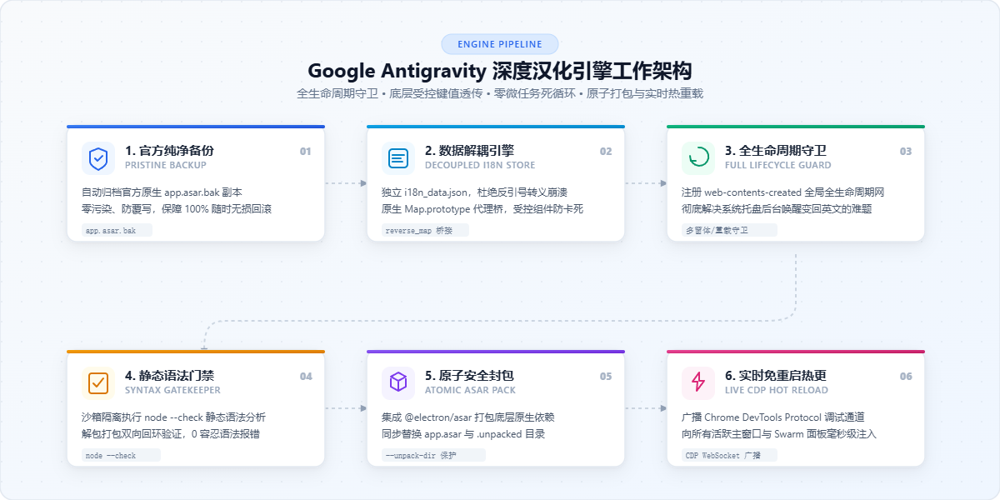

<div align="center">


# 🌌 Antigravity Chinese Locale (Chinesizing)

**Google Antigravity 客户端全界面企业级深度汉化与全生命周期持久化套件**

[](https://github.com/Jet-0920/Antigravity-Chinese-Locale/releases)
[](scripts/i18n_data.json)
[](scripts/i18n_data.json)
[](#-零感知实时热重载)
[](LICENSE)
[](#-环境要求)

<p align="center">
  <b>彻底根治「重启变回英文」、「下拉选项卡死假死」、「三键滑动闪现英文」、「路由切换失效」等传统痛点</b><br>
  提供媲美官方原生体验的 100% 持久、流畅、零崩溃的极致简体中文界面
</p>

[✨ 核心突破](#-核心突破-v25) • 
[🤖 智能体一句话汉化](#-智能体一键极速汉化极力推荐) • 
[💻 手动安装指南](#-手动安装指南) • 
[📊 方案优势对比](#-方案对比) • 
[❓ 常见问题 FAQ](#-常见问题--排查-faq)

</div>

---

## 🤖 智能体一键极速汉化（极力推荐）

> **💡 最省心的方式**：您甚至不需要自己打开终端或敲任何命令！只需把本仓库链接发送给您的 Antigravity 智能体即可。

### 💬 对 Antigravity 说一句话：

> **“帮我按照这个仓库中的内容汉化一下 Antigravity 客户端：https://github.com/Jet-0920/Antigravity-Chinese-Locale”**

---

### 📸 发现漏译或未汉化死角？截屏发给对话即可自动补全！

> **🔥 革命性的多模态自愈体验**：  
> 如果您在使用过程中发现任何残留的英文死角（如深层子弹窗、特定错误提示或插件详情）：  
> 1. 直接**截图（截屏）**该英文区域；  
> 2. 将截图发送至 Antigravity 对话框；  
> 3. 对智能体说一句：**“这个地方也帮我汉化一下”**；  
> 4. 智能体即可自动识别图中的英文文字、精准录入词库、通过语法门禁并进行毫秒级热重载生效！无需手动查找任何代码或繁琐配置。

---

### 📋 针对 Antigravity 智能体的执行指南 (For AI Agents)

<!-- ANTIGRAVITY_AGENT_INSTRUCTIONS_START -->
> [!NOTE]
> **致正在协助用户的 Antigravity 智能体**：  
> 当收到用户关于“按照本仓库进行汉化”的请求时，请直接在终端中按顺序执行以下跨平台自动化命令即可完成全套部署：
> 
> ```bash
> # 1. 克隆本仓库到临时或工作区目录
> git clone https://github.com/Jet-0920/Antigravity-Chinese-Locale.git
> cd Antigravity-Chinese-Locale
> 
> # 2. 执行安全持久化部署引擎（自动探测路径、备份 app.asar.bak、执行门禁并广播热重载）
> python scripts/deploy_chinese.py
> ```
> 
> **执行保障**：
> - 脚本已内建多平台资源路径自动探测（Windows / macOS / Linux）；
> - 自动创建官方原版备份 `app.asar.bak`；
> - 100% 通过 `node --check` 语法门禁后才执行原子写入；
> - 自动通过 CDP 协议向当前活跃窗口广播热重载，无需用户立即重启客户端即可呈现全中文！
<!-- ANTIGRAVITY_AGENT_INSTRUCTIONS_END -->

---

## 💻 快速安装指南 (人类用户专用)

如果您不想通过智能体，偏好在本地直接执行，本项目提供了三种极简方式：

### 🚀 方式一：终端一行命令极速安装（无需手动 git clone，极力推荐）

打开系统终端（PowerShell 或 Terminal），直接粘贴以下一行命令回车即可：

- **🪟 Windows (PowerShell)**：
  ```powershell
  irm https://raw.githubusercontent.com/Jet-0920/Antigravity-Chinese-Locale/main/install.ps1 | iex
  ```

- **🍎 macOS / 🐧 Linux (Bash/Zsh)**：
  ```bash
  curl -fsSL https://raw.githubusercontent.com/Jet-0920/Antigravity-Chinese-Locale/main/install.sh | bash
  ```

---

### 🖱️ 方式二：Windows 双击一键运行

1. 点击 GitHub 绿色代码按钮选择 **[Download ZIP](https://github.com/Jet-0920/Antigravity-Chinese-Locale/archive/refs/heads/main.zip)** 下载并解压；
2. 直接双击解压根目录下的 **`install.bat`** 即可自动完成全套安装。

---

### 🛠️ 方式三：常规 Git 本地克隆安装

```bash
# 克隆仓库
git clone https://github.com/Jet-0920/Antigravity-Chinese-Locale.git
cd Antigravity-Chinese-Locale

# Windows:
python scripts\deploy_chinese.py
# 或运行: .\install.ps1

# macOS / Linux:
chmod +x install.sh && ./install.sh
# 或运行: python3 scripts/deploy_chinese.py
```

---

## ✨ 核心突破 (v2.5)

| 突破维度 | 技术机理与用户体验价值 |
| :--- | :--- |
| 🌐 **2,999+ 精准词条全覆盖** | 全面汉化**常规设置、应用配置、外观主题、快捷键管理、模型用量与配额、网络权限、自动化定时任务自定义周期、插件市场（Marketplace）全分类及详情页、右键菜单、浏览器自动化工具**等全部死角。 |
| ⚡ **Tooltip 0ms 滑动防漏自愈** | 为浮层配置**微型独立私有互斥锁** + **指针移动 0ms 同步查表校准**，彻底解决在「复制、好评、差评」三键之间极速滑动切换时偶发/高频变回英文的业界技术难题。 |
| 🔄 **全生命周期守卫 (防重启失效)** | 挂载于 Electron 全局 `app.on('web-contents-created')`，全面守卫 `dom-ready`、`did-finish-load` 与 `did-navigate-in-page`，并在 `showOrCreateWindow` 唤醒链路中注入补偿，彻底根绝“关闭重开变回英文”的托盘缓存顽疾。 |
| 🛡️ **底层双向映射桥 (反向透传防卡死)** | 全局拦截 `Map.prototype.has` 与 `get`，当 Base UI / Radix UI 等受控组件接收到汉化后的中文选项时，自动反向透传原生英文 Key，彻底杜绝下拉菜单选不中、弹窗无法关闭、焦点锁死假死问题。 |
| 💡 **纯值比对自愈 (弃用 WeakSet)** | 坚决抛弃有害的引用型 `WeakSet` 永久黑名单，采用纯值动态比对算法。单页应用（SPA）动态路由跳转、异步加载组件时毫秒级自动重译，绝不中途失效。 |
| 🔒 **严格语法门禁先行** | 修改写入生产包 `app.asar` 前，强制在沙箱临时目录中执行 `node --check` 语法分析闭环，0 报错才执行原子替换，确保客户端 100% 稳定拉起。 |
| ⚡ **零感知实时热重载** | 集成 Chrome DevTools 协议（CDP），安装完成后即时向当前活跃的页面与伴生面板广播热更新，无需立即重启即可见证汉化效果。 |

---

## 📊 方案对比

| 衡量维度 | 传统外挂脚本 / 简单正则 | 常见油猴/DOM 插件 | **Antigravity-Chinese-Locale (本项目)** |
| :---: | :---: | :---: | :---: |
| **词库完整度** | < 800 条，中英夹生严重 | 仅覆盖主聊天区 | **2,999+ 条高精词条 + 233 项受控映射 + 257 项动态规则** |
| **重启持久性** | ❌ 退出托盘重开立即变回英文 | ❌ 需每次刷新重新注入 | **✔️ 全生命周期拦截网，重启/刷新/唤醒 100% 持久生效** |
| **受控组件兼容** | ❌ 下拉菜单点击假死、弹窗无法关闭 | ❌ 破坏 React 内部状态 | **✔️ 原生 Map 原型链代理，双向无缝反查原生 Key** |
| **三键滑动切换** | ❌ 滑动切换闪现英文（Good/Bad Response）| ❌ 无法监听复用 DOM 的文本流 | **✔️ 专属微型私有锁 + 0ms 指针即时校准，毫无闪烁** |
| **运行安全性** | ❌ 偶发 SyntaxError 导致应用崩溃打不开 | ❌ characterData 循环引发 CPU 100% 卡死 | **✔️ 纯 childList 拓扑扫描 + `node --check` 语法门禁** |
| **生效方式** | 需手动反复重启客户端 | 依赖前端注入环境 | **✔️ 本地原子生产打包 + CDP 毫秒级免重启热更新** |

---

## ⚙️ 环境要求

- **操作系统**：Windows 10/11、macOS 或 Linux
- **Google Antigravity 客户端**：任何官方版本
- **Node.js**：v18.0.0 或更高版本（需在系统环境变量中支持 `npx`）
- **Python**：3.8 或更高版本（仅使用 Python 标准库，**无需任何 pip 安装**）

---

## 🛠️ 工作原理架构 (Architecture Pipeline)

<div align="center">
  
</div>

<br>

| 流水线阶段 | 核心防护机理与设计目标 |
| :--- | :--- |
| **1. 官方纯净备份 (Pristine Backup)** | 初次运行自动归档原生 `app.asar.bak`，保留随时 100% 官方无损回滚能力。 |
| **2. 数据解耦存储 (Decoupled i18n)** | 独立标准 `i18n_data.json` 存储，杜绝在主进程或执行脚本中硬编码反引号造成的 SyntaxError。 |
| **3. 全生命周期守卫 (Full Lifecycle Guard)** | 挂载于 `app.on('web-contents-created')` 与 `showOrCreateWindow`，彻底攻克重启与托盘唤醒失效。 |
| **4. 静态语法门禁 (Syntax Gatekeeper)** | 在沙箱隔离环境中强制执行 `node --check` 语法分析，确保任何改动 0 报错才准许打包。 |
| **5. 原子安全封包 (Atomic Production Pack)** | 双向同步 `app.asar` 与 `.unpacked` 依赖目录，确保底层原生 C++ 二进制模块 0 缺失。 |
| **6. 零感知实时热更 (Live CDP Hot Reload)** | 广播 Chrome DevTools Protocol，向所有活跃窗口动态应用最新词库，无需重启即刻生效。 |

---

## ❓ 常见问题 & 排查 (FAQ)

### Q1：安装完成后，界面已经变成中文，但关闭窗口重新打开又变回英文了？
> **原因分析**：Antigravity 默认开启了「系统托盘常驻后台（Run in background）」。当您点击窗口右上角“X”关闭时，主进程其实并没有真正退出，内存中依然驻留着旧模块缓存。  
> **解决办法**：
> 1. 请在 Windows 任务栏右下角找到 Antigravity 小图标，**右键选择「Quit / 退出」**；
> 2. （或在任务管理器中彻底结束 Antigravity 相关进程）；
> 3. 重新从桌面或开始菜单启动客户端，即可从磁盘加载新打包的 `app.asar` 并永久生效！

### Q2：如何卸载汉化，恢复为官方原版英文？
> 本安装器在初次运行时会自动在客户端 resources 目录下创建官方原版的纯净副本 **`app.asar.bak`**。  
> **一键恢复官方原版**：
> 1. 进入客户端资源目录（例如 Windows 路径：`%LOCALAPPDATA%\Programs\antigravity\resources\`）；
> 2. 将当前的 `app.asar` 删除，并将 `app.asar.bak` 重命名为 `app.asar`；
> 3. 彻底重启客户端即可完全恢复原样。

### Q3：官方客户端更新版本后汉化失效了怎么办？
> 官方客户端更新会拉取全新的 `app.asar`。此时只需再次对您的智能体说一句话：  
> **“帮我按照这个仓库重新汉化一下 Antigravity：https://github.com/Jet-0920/Antigravity-Chinese-Locale”**  
> 脚本会自动重新执行全流程适配。

### Q4：使用中如果发现某处界面还是英文，该如何反馈或快速补齐？
> **截图即汉化（无需手动提取文本）**：  
> - **方式 A（发给智能体，秒级自愈）**：直接把未汉化的英文区域**截屏发给正在对话的 Antigravity**，并说一句：“这个地方也帮我汉化一下”，智能体将全自动识别、收录并热更新生效！  
> - **方式 B（提交 Issue）**：将截图直接上传至 GitHub 的 [Issues](https://github.com/Jet-0920/Antigravity-Chinese-Locale/issues)，我们会第一时间收录并更新官方词库。

---

## 🤝 持续更新与开源贡献

- 遇到未汉化的界面死角或表述不够准确？欢迎直接阅读 [贡献指南 (CONTRIBUTING.md)](CONTRIBUTING.md) 提交 [Pull Request](https://github.com/Jet-0920/Antigravity-Chinese-Locale/pulls)！
- 发现任何漏译死角，欢迎提交 [Issue 漏译反馈](https://github.com/Jet-0920/Antigravity-Chinese-Locale/issues)（支持直接粘贴截图）；
- 欢迎给本项目点个 ⭐️ **Star**，支持我们持续维护与演进！

---

## 📄 开源许可证

本项目基于 [MIT 许可证](LICENSE) 开源。

**免责声明**：本项目为独立开源的本地化增强扩展，旨在提升中文开发者的使用体验，与 Google 官方无关。请在遵循软件许可的前提下合法合规使用。
